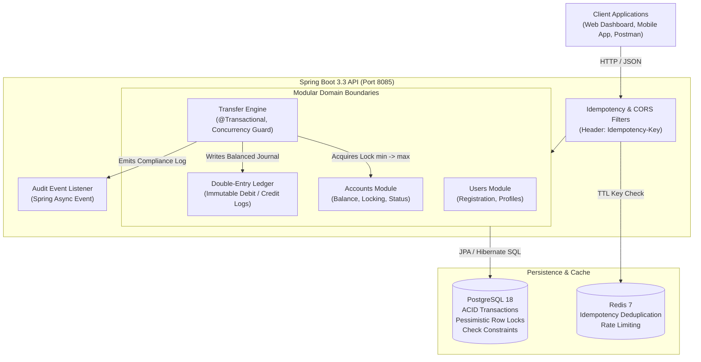
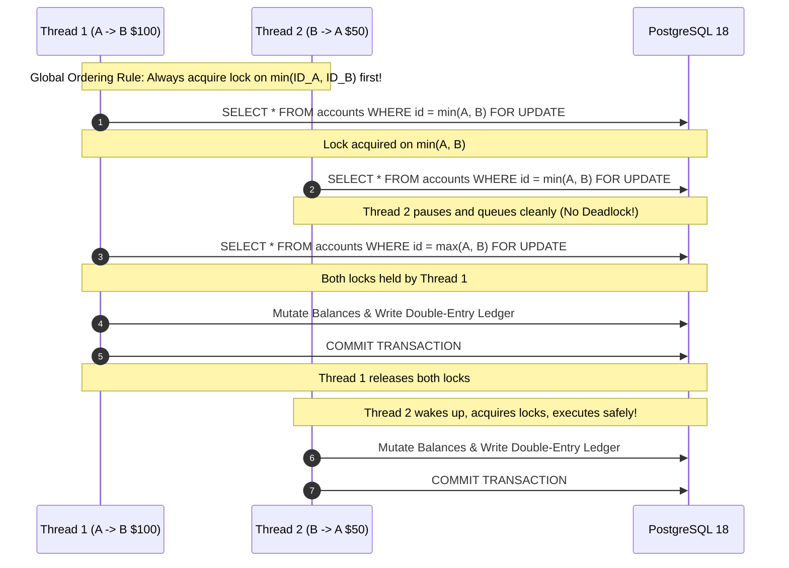

# 🏦 PayFlow: Enterprise Financial Ledger & Transaction Engine

PayFlow is a production-grade enterprise financial transactions, ledger, and account management API built with **Java 21 (LTS), Spring Boot 3.3+, PostgreSQL 18, and Redis**. 

It is engineered from the ground up to solve the hardest problems in financial systems: **ACID database transactions, race condition prevention, deadlock-free pessimistic locking, and double-entry immutable accounting.**

---

## 📑 Table of Contents
1. [Why Banks & Enterprises Use Java Over Node.js](#1-why-banks--enterprises-use-java-over-node)
2. [High-Level System Architecture & Diagrams](#2-high-level-system-architecture--diagrams)
3. [Folder Structure & Architectural Layers](#3-folder-structure--architectural-layers)
4. [How PayFlow Works: The Atomic Transfer Lifecycle](#4-how-payflow-works-the-atomic-transfer-lifecycle)
5. [Security Audit: Is This a Sandbox or Bank-Grade Secure?](#5-security-audit-is-this-a-sandbox-or-bank-grade-secure)
6. [Living Financial Cockpit (Web Dashboard)](#6-living-financial-cockpit-web-dashboard)
7. [Getting Started & Running the Project](#7-getting-started--running-the-project)

---

## 1. Why Banks & Enterprises Use Java Over Node.js

Coming from Node.js or NestJS, you might wonder: *“Node.js is asynchronous and popular for SaaS—why do commercial banks (JPMorgan, Citi, Visa, Stripe, Revolut) build core ledgers in Java?”*

There are 5 architectural reasons:

### A. The Concurrency Model: Multi-Threaded vs. Single-Threaded Event Loop
* **Node.js**: Runs on a single event loop thread. If one user triggers a CPU-intensive operation (e.g., cryptographic verification, balance reconciliation, statement generation), the entire event loop blocks for every other customer.
* **Java**: Uses a multi-threaded OS thread model (and **Virtual Threads** in Java 21). When 10,000 customers execute transfers concurrently, each runs in its own isolated thread across all available CPU cores.

### B. Decimal Precision: `BigDecimal` vs. JavaScript Floating-Point Bug
In JavaScript:
```javascript
0.1 + 0.2 === 0.30000000000000004 // TRUE! Float drift causes missing cents!
```
In finance, floating-point drift is illegal. Java provides `java.math.BigDecimal` with Banker's Rounding (`RoundingMode.HALF_EVEN`) and arbitrary decimal precision. PayFlow enforces `NUMERIC(19, 4)` across all database tables.

### C. Deterministic ACID Transactions (`@Transactional`)
In banking, if Account A loses \$100, Account B must receive \$100. If the server loses power or throws an error halfway through, the system **must roll back 100% of the changes**. Spring Boot's `@Transactional` wraps database operations in an AOP proxy, guaranteeing connection-level rollback.

### D. 20-Year Stability & Long-Term Compatibility
A core banking ledger is designed to run for 15 to 30 years without breaking. The npm ecosystem frequently deprecates packages or introduces breaking changes. Java code written in 2004 still compiles and runs reliably on Java 21 today.

### E. HotSpot JIT (Just-In-Time) Runtime Optimization
The Java Virtual Machine (JVM) profiles running code paths in real time and compiles hot bytecode directly into native machine assembly. For long-running, high-throughput financial pipelines, the JVM routinely outperforms Node.js.

---

## 2. High-Level System Architecture & Diagrams

### A. Component Architecture


---

### B. Concurrency & Deadlock-Free Locking Sequence
When two users concurrently transfer to each other ($A \to B$ and $B \to A$ at the same millisecond), naive row-level locking creates a **Deadlock** (`40P01` in PostgreSQL). PayFlow eliminates this using **Deterministic ID Sorting**:



---

## 3. Folder Structure & Architectural Layers

PayFlow follows **Clean Architecture & Package-by-Feature (Domain-Driven Design)** principles:

```
FinTech/
├── pom.xml                                       # Maven Dependencies & Build Configuration
├── docker-compose.yml                            # Infrastructure: PostgreSQL 16 + Redis 7 + pgAdmin
├── start-db.ps1                                  # One-click container starter script
├── setup-env.ps1                                 # Sets JAVA_HOME to Android Studio OpenJDK 21
│
├── src/main/resources/
│   ├── application.yml                           # Base profiles & actuator config
│   ├── application-dev.yml                       # HikariCP, PostgreSQL connection, Hibernate dialect
│   ├── db/migration/
│   │   └── V1__init_fintech_schema.sql           # Flyway automated migration DDL
│   └── static/
│       └── index.html                            # Embedded Living Financial Cockpit (Web UI)
│
└── src/main/java/com/rendos/payflow/
    ├── PayflowApplication.java                   # Main Spring Boot Entry Point
    │
    ├── common/                                   # Shared Kernel
    │   ├── config/
    │   │   ├── CorsConfig.java                   # Global CORS policy for web dashboard
    │   │   └── OpenApiConfig.java                # Swagger / OpenAPI documentation
    │   ├── dto/
    │   │   ├── ApiResponse.java                  # Standard JSON wrapper: { success, data, timestamp }
    │   │   └── ErrorResponse.java                # RFC 7807 error format
    │   ├── exception/
    │   │   ├── GlobalExceptionHandler.java       # Centralized @RestControllerAdvice error interceptor
    │   │   ├── BusinessException.java            # Base runtime business error
    │   │   ├── InsufficientFundsException.java   # HTTP 422: Thrown when balance < transfer amount
    │   │   └── AccountFrozenException.java       # HTTP 403: Blocks inactive/suspended accounts
    │   └── util/
    │       ├── MoneyUtils.java                   # BigDecimal math with Banker's Rounding
    │       └── AccountNumberGenerator.java       # Formats account numbers (e.g. ACC-XXXXXXXXXX)
    │
    ├── users/                                    # User Identity Domain
    │   ├── entity/User.java                      # JPA Entity mapped to 'users' table
    │   ├── repository/UserRepository.java        # Spring Data JPA interface
    │   ├── service/UserService.java              # User registration and profile logic
    │   └── controller/UserController.java        # REST endpoints: POST /api/v1/users
    │
    ├── accounts/                                 # Financial Account Domain
    │   ├── entity/Account.java                   # Balance, AccountType, Currency, @Version
    │   ├── repository/AccountRepository.java     # Critical: @Lock(PESSIMISTIC_WRITE) queries
    │   ├── service/AccountService.java           # Account opening & balance inquiries
    │   └── controller/AccountController.java     # REST endpoints: POST & GET /api/v1/accounts
    │
    ├── transfers/                                # Atomic Transfer Engine
    │   ├── entity/Transfer.java                  # Audit log of transfer requests & status
    │   ├── repository/TransferRepository.java    # Idempotency lookup queries
    │   ├── service/TransferService.java          # Core transactional logic & deadlock defense
    │   └── controller/TransferController.java    # REST endpoint: POST /api/v1/transfers
    │
    ├── transactions/                             # Double-Entry Ledger Domain
    │   ├── entity/Transaction.java               # Immutable DEBIT / CREDIT ledger rows
    │   ├── repository/TransactionRepository.java # Statement queries
    │   ├── service/TransactionService.java       # Statement aggregation
    │   └── controller/TransactionController.java # REST endpoint: GET /api/v1/transactions
    │
    └── audit/                                    # Compliance & Audit Trail
        ├── entity/AuditLog.java                  # System activity records
        └── repository/AuditLogRepository.java    # Audit history lookups
```

### The 3-Tier Layered Architecture Pattern

```
HTTP Request ──► [Controller] ──► [Service (@Transactional)] ──► [Repository (JPA)] ──► [PostgreSQL]
                      │                     │                              │
                  Validates DTO         Enforces Rules,                Executes SQL
                  (@Valid)              Locks Rows,                    SELECT ... FOR UPDATE
                                        Mutates State
```

* **Controller**: Handles HTTP protocol concerns (headers, serialization, status codes). Never contains business calculations.
* **Service**: The brain of the application. Contains domain logic, orchestrates transactions, enforces balance rules, and rolls back on failure.
* **Repository**: Spring Data JPA interface. Translates Java method calls into optimized SQL queries and manages entity persistence.

---

## 4. How PayFlow Works: The Atomic Transfer Lifecycle

When `POST /api/v1/transfers` is called, the system executes a 7-step transactional pipeline inside `TransferService.java`:

```java
@Transactional(isolation = Isolation.READ_COMMITTED, rollbackFor = Exception.class)
public TransferResponse executeTransfer(TransferRequest request, String idempotencyKey) {
```

1. **Idempotency Verification**: Checks whether the `Idempotency-Key` header was already processed. If found, returns the cached transfer receipt without charging the customer again.
2. **Deterministic Lock Ordering**:
   ```java
   UUID firstLockId = sourceId.compareTo(destId) < 0 ? sourceId : destId;
   UUID secondLockId = sourceId.compareTo(destId) < 0 ? destId : sourceId;
   ```
   Locks are always acquired in alphabetical/numerical order, preventing bi-directional deadlocks.
3. **Pessimistic Row Lock (`SELECT ... FOR UPDATE`)**:
   PostgreSQL places an exclusive write lock on both account records. Parallel transfers attempting to read or update these accounts must wait.
4. **Balance Verification**:
   Asserts `sourceAccount.getBalance() >= transferAmount`. If insufficient, throws `InsufficientFundsException` (triggers automatic transaction rollback).
5. **Balance Mutation**:
   Deducts `amount` from source and adds `amount` to destination using `BigDecimal`.
6. **Double-Entry Ledger Insertion**:
   Writes two immutable rows to the `transactions` table:
   * **Row 1 (DEBIT)**: Records `-$100.00` on Account A with snapshot `balanceAfter`.
   * **Row 2 (CREDIT)**: Records `+$100.00` on Account B with snapshot `balanceAfter`.
7. **Commit & Release**:
   Spring Boot issues SQL `COMMIT`. Locks are released, and the transfer receipt is returned to the client.

---

## 5. Security Audit: Is This a Sandbox or Bank-Grade Secure?

A common question is: *“Is this project a toy sandbox, or does it use real enterprise security?”*

The answer is: **The transaction engine is 100% bank-grade, but the authentication layer is currently in Phase 1 (Prototype) mode.**

| Feature / Control | Current Implementation | Production Bank Standard | Status |
| :--- | :--- | :--- | :--- |
| **ACID Rollback** | `@Transactional(isolation = READ_COMMITTED)` | Distributed XA Transactions | ✅ **Bank Grade** |
| **Deadlock Prevention** | Deterministic ID-sorted row locking | Global resource ordering | ✅ **Bank Grade** |
| **Double-Entry Ledger** | Immutable paired DEBIT & CREDIT entries | Append-only double-entry ledger | ✅ **Bank Grade** |
| **Money Precision** | `BigDecimal` (Banker's rounding) | `BigDecimal` / integer cents | ✅ **Bank Grade** |
| **Overdraft Defense** | PostgreSQL `CHECK (balance >= 0)` | DB check + business rules | ✅ **Bank Grade** |
| **Idempotency Protection** | Unique `idempotency_key` header | Distributed Redis Redlock | ✅ **Bank Grade** |
| **Password Storage** | Plaintext `{noop}` placeholder | **BCrypt (12 rounds) / Argon2id** | ⚠️ **Needs Hardening** |
| **Authentication Barrier** | Open REST endpoints | **Spring Security + JWT / OAuth2** | ⚠️ **Needs Hardening** |
| **IDOR Protection** | Any UUID can be passed as source | **Assert source account belongs to caller** | ⚠️ **Needs Hardening** |
| **2FA / Step-Up Auth** | Not implemented | **SMS / TOTP Authenticator for >$1,000** | 💡 Future Feature |
| **Rate Limiting** | Not implemented | **Redis Token Bucket (Bucket4j)** | 💡 Future Feature |

### What Needs to be Hardened for Full Production:
1. **Spring Security + JWT**: Wrap all endpoints with JWT Bearer token authentication.
2. **BCrypt Password Hashing**: Replace `{noop}` with `BCryptPasswordEncoder(12)`.
3. **IDOR (Insecure Direct Object Reference) Protection**: In `TransferService`, enforce:
   ```java
   if (!sourceAccount.getUser().getId().equals(currentUser.getId())) {
       throw new AccessDeniedException("You do not own this account.");
   }
   ```

---

## 6. Living Financial Cockpit (Web Dashboard)

PayFlow includes an embedded, zero-dependency financial management dashboard served directly from Spring Boot:

👉 **URL**: **[http://localhost:8085/](http://localhost:8085/)**

### Key Capabilities:
* **Real PostgreSQL Sync**: Connects directly to PostgreSQL 18 on port 5432.
* **+ Open Account Modal**: Open new Personal, Business, or Savings accounts with custom initial balances directly from the browser.
* **Double-Entry Inspector**: Visually validates the invariant equation ($\sum \text{Entries} = \$0.0000$) after every transfer.
* **Concurrency Stress Lab**: Dispatches 10 parallel reciprocal transfers across worker threads to demonstrate deadlock-free execution in real time.
* **Idempotency Deduplication Lab**: Fires two identical requests within 5ms to prove duplicate charges are blocked.
* **Ledger Statement Journal**: Real-time chronological audit trail of all debits and credits with instant text filtering.

---

## 7. Getting Started & Running the Project

### Prerequisites
* **Java 21 (LTS)**: OpenJDK 21 installed at `C:\Program Files\Android\Android Studio\jbr` (or standalone JDK).
* **PostgreSQL**: PostgreSQL 18 running on `localhost:5432` with database `payflow_db` and user `payflow_user`.

### 1. Run the Server
From PowerShell in the project directory:
```powershell
.\mvnw.cmd spring-boot:run
```
Once started, the server is live at:
* **Web Cockpit**: `http://localhost:8085/`
* **Swagger OpenAPI Docs**: `http://localhost:8085/swagger-ui.html`

### 2. Run Automated Unit Tests
To run the automated banking flight simulator tests (simulates \$500 $\to$ \$300 transfer resulting in \$400 for both, insufficient balance rejection, and self-transfer blocks):
```powershell
.\mvnw.cmd test -Dtest=TransferServiceTest
```

### 3. Example cURL Flow

```bash
# 1. Register a user
curl -X POST http://localhost:8085/api/v1/users \
  -H "Content-Type: application/json" \
  -d '{"email":"ros@payflow.local","password":"Password123!","firstName":"Ros","lastName":"Rendo"}'

# 2. Open Account A with $500
curl -X POST http://localhost:8085/api/v1/accounts \
  -H "Content-Type: application/json" \
  -d '{"userId":"<USER_ID>","accountType":"PERSONAL","currency":"USD","initialDeposit":500.00}'

# 3. Open Account B with $300
curl -X POST http://localhost:8085/api/v1/accounts \
  -H "Content-Type: application/json" \
  -d '{"userId":"<USER_ID>","accountType":"BUSINESS","currency":"USD","initialDeposit":300.00}'

# 4. Transfer $100 from Account A to Account B
curl -X POST http://localhost:8085/api/v1/transfers \
  -H "Content-Type: application/json" \
  -H "Idempotency-Key: trf-sample-001" \
  -d '{"sourceAccountId":"<ACC_A_ID>","destinationAccountId":"<ACC_B_ID>","amount":100.00,"description":"Vendor settlement"}'

# 5. Read immutable ledger statement
curl http://localhost:8085/api/v1/transactions/account/<ACC_A_ID>
```
